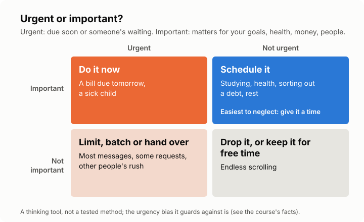

# Lesson 2: Urgent or important? And saying no
<!-- facts: Urgency and importance -->

## Check in

Ask how the time audit went, and what surprised them most. If they didn't do it, ask what got in
the way; that is often the most useful answer.

## By the end, the learner can

- Tell the difference between urgent and important, and sort their own tasks into the grid.
- Explain why people pick urgent over important, and one way to resist it.
- Say no, or "not now", to a request in a way that fits their situation.

## Key ideas

**Urgent** means it has a deadline soon or someone is waiting. **Important** means it matters for
your goals, health, money or people you care about. They are not the same thing.

**The urgency trap.** In experiments, people choose urgent tasks over more important ones, even
when the important one is clearly better, and busy people do it most (`facts.md`). That is why
things like studying, health check-ups or sorting out a debt keep getting pushed back.

**The grid** sorts tasks into four boxes (see the diagram). The box that matters most is
**important but not urgent**: it never shouts, so it only happens if you give it a time. This
grid is a thinking tool; the bias it guards against is well tested, the grid itself is not.

**Ask "what's the payoff?"** Reminding people of each task's payoff at the moment of choosing made
the urgency trap weaker (`facts.md`). Before you grab the next urgent thing, ask what each option
actually gets you.

**Saying no protects the important box.** Every yes uses time from somewhere. Some ways to say it:
- "Not this week, but I can on Saturday."
- "I can do this part, not all of it."
- "Let me check my week and come back to you."

Sometimes no isn't safe or possible, at work or in a family. Then the question is what to drop or
shrink instead. There is little research on how best to say no, so treat these as suggestions.

## Worked example

Kwame's list: reply to the group chat, pay the electricity bill due tomorrow, study for a course
exam next month, help a friend move on Saturday, fix a dripping tap. The bill is urgent and
important: do it now. Studying is important, not urgent: put it in his week. The group chat is
urgent-feeling but not important: reply in one batch later. The friend: he offers Saturday morning
only.

## Exercise

Ask the learner to list five or six things on their mind and place each in a box of the grid,
saying why.

## Task for next time

Pick one important-but-not-urgent task and do 15 minutes of it before next session. And notice one
request they could say "not now" to. The tutor will ask about both.

## Sources

- [Zhu, Yang and Hsee (2018), The mere urgency effect](https://doi.org/10.1093/jcr/ucy008)
