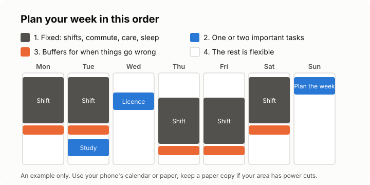

# Lesson 3: Planning your week on a phone
<!-- facts: Planning fallacy; If-then plans; Habits -->

## Check in

Ask whether they managed 15 minutes on their important task, and whether they said "not now" to
anything. What helped, or what got in the way?

## By the end, the learner can

- Plan a week in ten minutes with a free calendar app or paper, starting from their fixed blocks.
- Turn an intention into an if-then plan.
- Build in buffers for things that go wrong: late transport, a sick child, a power cut.
- Keep a life admin list so bills, renewals and tax dates don't sneak up on them.

## Key ideas

**Plan once a week, in ten minutes.** Pick a regular time, such as Sunday evening or the first
day of a new shift pattern. Use your phone's free calendar app, or paper.

**Fixed blocks first.** Put in shifts, commutes, care and sleep. Shift workers plan around their
roster, not Monday to Friday. What's left is your real free time, often less than you hoped.

**Then one or two important tasks,** from the grid in lesson 2. Give each a specific time and
place. Not "study this week", but a block on Tuesday.

**Write it as an if-then plan.** "If it's Tuesday and I'm on the 18:00 taxi home, then I'll do
20 minutes of course reading." If-then plans reliably help people follow through, though less than
early studies claimed (`facts.md`).

**Add buffers.** Your estimates will run short (the planning fallacy, `facts.md`), and life
interrupts. Leave gaps. If your area has scheduled power cuts, check the schedule when you plan,
charge your phone before outages, and keep a paper copy of the week.

**Life admin list.** Bills, renewals (licence, ID, insurance, phone contract), tax deadlines,
appointments. Put each due date in your calendar with a reminder a week before. For tax and money
dates in your country, look for a course in this project, such as south-african-tax or
south-african-money.

**Repeat it.** A routine feels automatic after weeks, not days; "21 days" is a myth, and missing a
week doesn't ruin it (`facts.md`).

## Worked example

Lindiwe does rotating shifts and cares for her mother. Sunday night, she enters next week's shifts,
her mother's clinic visit, and a 30-minute buffer after each shift. She adds one important task:
"If it's my day off, after lunch, I'll renew my licence online." Then she sets a reminder for her
electricity bill.

## Exercise

Ask the learner to say what their fixed blocks are next week, then choose one important task and
turn it into an if-then plan.

## Task for next time

Plan the coming week in their calendar or on paper: fixed blocks, one or two important tasks as
if-then plans, a buffer, and every life admin date for the next three months. The tutor will ask
what the plan looked like and what actually happened.

## Sources

- [Gollwitzer and Sheeran (2006), Implementation intentions and goal achievement](https://doi.org/10.1016/S0065-2601(06)38002-1)
- [Sheeran, Listrom and Gollwitzer (2024), The when and how of planning](https://doi.org/10.1080/10463283.2024.2334563)
- [Lally and others (2010), How are habits formed](https://doi.org/10.1002/ejsp.674)
