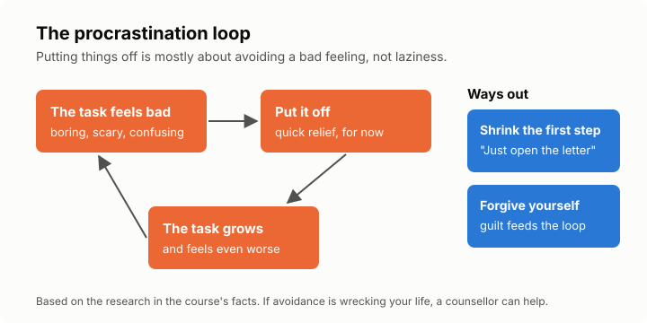

# Lesson 4: Procrastination
<!-- facts: Procrastination; Unproven productivity claims -->

## Check in

Ask how the week plan went. Which parts held, and which fell apart? Did the buffers help? Planning
again with what they learned is the skill, so a plan that broke is not a failure.

## By the end, the learner can

- Explain procrastination as avoiding a bad feeling, not as laziness.
- Use at least two techniques with research behind them: a tiny start and self-forgiveness.
- Say when procrastination may need more help than a technique.

## Key ideas

**It's about feelings, not laziness.** People put off tasks that feel unpleasant, boring or
confusing, especially when the reward is far away (`facts.md`). Avoiding the task makes you feel
better right now. That relief is the trap: next time, the task feels even worse.

**Shrink the first step.** "Do my tax" feels awful. "Find last year's certificate" doesn't. Make
the first step so small it feels silly: open the document, write one sentence, look up the phone
number. Starting is the hard part; once started, people often carry on.

**Make the reward closer.** Pair the task with something you like (music, tea), or tick it off
somewhere you can see.

**Forgive yourself.** It sounds soft, but students who forgave themselves for putting off studying
procrastinated less next time (`facts.md`). Beating yourself up adds to the bad feeling that caused
the delay.

**Use an if-then plan** from lesson 3: "If I sit down after supper, then I'll open the bill and
read the first page."

**When it's bigger.** If procrastination is wrecking work, study or money, help exists. Across
studies, cognitive behavioural therapy (CBT) helped most (`facts.md`). A counsellor, a university
or college support service, or a doctor can point you to it. Constant avoidance can also come with
anxiety or low mood; the managing-stress course in this project covers that side.

**Beware tips sold as science.** Some popular rules have no research behind them (`facts.md`).
That doesn't mean they can't help you, just that nobody has shown they work.

## Worked example

Thabo has an unopened letter from his bank for three weeks. Each day it sits there, it feels worse.
His tiny step: "Tonight, I'll open it and read only the first line." He does, and it's a routine
statement. The dread was much bigger than the task.

## Exercise

Ask the learner to name one task they're avoiding and what feeling it brings up. Then ask them to
shrink the first step until it feels almost too easy.

## Task for next time

Do that tiny first step before next session, and notice how it felt before and after. The tutor
will ask.

## Sources

- [Steel (2007), The nature of procrastination](https://doi.org/10.1037/0033-2909.133.1.65)
- [Sirois and Pychyl (2013), Procrastination and short-term mood regulation](https://doi.org/10.1111/spc3.12011)
- [Wohl, Pychyl and Bennett (2010), I forgive myself, now I can study](https://doi.org/10.1016/j.paid.2010.01.029)
- [van Eerde and Klingsieck (2018), Overcoming procrastination?](https://doi.org/10.1016/j.edurev.2018.09.002)
